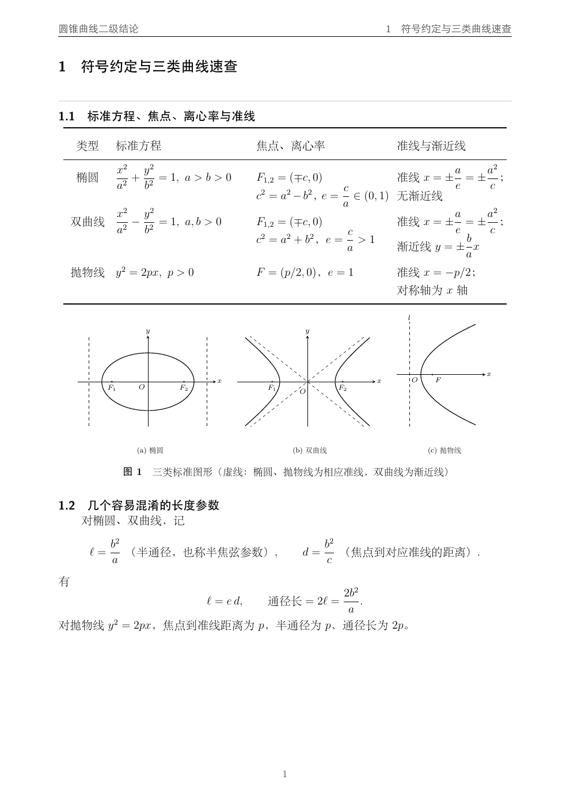

<div align="center">

# 圆锥曲线二级结论

**高中数学 · 高考复习 · 专题汇总**

椭圆 / 双曲线 / 抛物线

20 页讲义 · 35 个专题 · A4 打印

[在线阅读](./圆锥曲线二级结论.pdf)　/　[下载 PDF](https://github.com/jielosc/conic-sections-notes/raw/refs/heads/main/圆锥曲线二级结论.pdf)　/　[LaTeX 源码](./圆锥曲线二级结论.tex)

</div>

---

一份面向**高中生与高考数学复习**的圆锥曲线二级结论汇总。

从焦半径、焦点弦到切线、弦长与轨迹，集中整理椭圆、双曲线、抛物线的常用公式、适用条件与推导线索。适合日常学习、高三一轮与二轮复习，以及考前查阅。

**把零散的结论，整理成清晰的解题线索。**

## 内容一览

| 专题 | 内容 |
| :--- | :--- |
| 基础速查 | 标准方程、焦点、离心率、准线与渐近线 |
| 通用结论 | 焦半径、参数方程、切线与极线、韦达定理、弦长与点差法 |
| 椭圆 | 焦点三角形、焦点弦、切线与法线、面积上界、光学性质 |
| 双曲线 | 同支与异支、渐近线性质、焦点弦、共轭双曲线、反射性质 |
| 抛物线 | 弦与中点、焦点弦、切线交点、圆性质、阿基米德三角形 |

讲义配有几何示意图、条件说明与部分推导，另收录共轭直径、准圆、内心轨迹等进阶内容。

## 内页预览

精选 9 页正文，涵盖通用结论、椭圆、双曲线与抛物线。点击图片可查看高清大图。

<p align="center">
  <a href="./assets/preview.png">
    
  </a>
</p>

<details>
<summary>源码与编译</summary>

PDF 可直接阅读、下载与打印。需要修改讲义时，使用包含中文支持的 TeX Live / MacTeX，通过 XeLaTeX 编译：

```bash
latexmk -xelatex -interaction=nonstopmode -halt-on-error "圆锥曲线二级结论.tex"
```

图形使用 TikZ 绘制，无需额外图片素材。若 macOS 提示缺少 `STHeiti` 字体，可将源码首行改为以下内容后编译，字形与分页可能略有变化：

```latex
\documentclass[UTF8,fontset=fandol,zihao=-4,a4paper]{ctexart}
```

</details>

---

欢迎通过 [Issues](https://github.com/jielosc/conic-sections-notes/issues) 提交勘误与建议。
